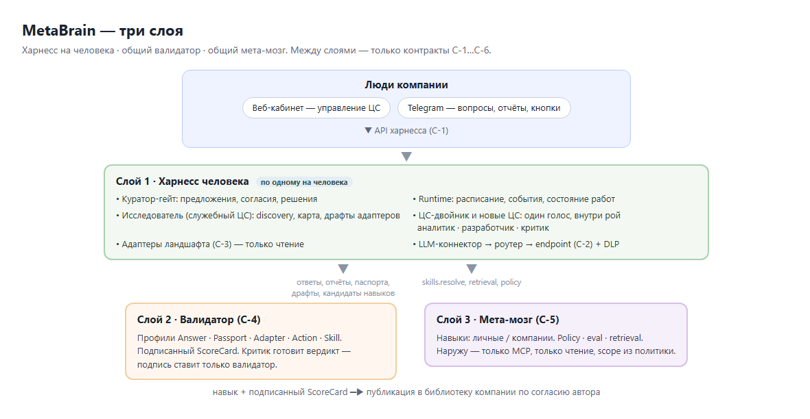

# MetaBrain — архитектура

Обзор для технических стейкхолдеров, ИТ-служб заказчика и интеграторов: из чего состоит система, как устроено доверие и изоляция, как подключаются системы компании, как это разворачивается. Документ — верхнеуровневый; формальные контракты и инварианты — в `specs/` (C-1…C-6, конституция, требования), пошаговый план — в `specs/50-tasks.md`.

Отметки статуса: **[демо]** — работает в демо-срезе и проверено сквозным тестом; **[MVP]** — целевой MVP; **[план]** — за пределами MVP.

## 1. Что это и принципы

MetaBrain — «фабрика цифровых сотрудников»: у каждого человека компании свои цифровые сотрудники (ЦС), работающие в его роли. Архитектура подчинена нескольким незыблемым правилам (конституция, `specs/01-constitution.md`):

- **Спеки — источник истины.** Код следует контрактам C-1…C-6, не наоборот.
- **Харнесс — на человека.** Изоляция между пространствами по умолчанию, в т.ч. внутри компании; между компаниями — без исключений.
- **Агент не выдаёт себе доступ.** Подключения и права — по явному согласию куратора; секреты — только в хранилище секретов, не в коде, промтах, логах.
- **Детерминированные гейты поверх вероятностной модели.** Валидатор — отдельный контур с подписью; модель — советник, не авторитет.
- **Самоулучшение через гейт.** Адаптеры, навыки, паспорта ролей *драфтятся* как артефакты → валидатор → согласие куратора → применение. Непроверенное не применяется никогда.
- **Старт только на чтение; запись — по лестнице автономии.**
- **Provenance и наблюдаемость встроены.** Каждый ответ — с источниками; стоимость модели — отдельной строкой на харнесс и ЦС.
- **Опыт покидает харнесс только как навык** — обезличенный, через валидатор и согласие автора.

## 2. Три слоя




```
 Люди компании ── веб-кабинет (управление ЦС) ──┐
               └─ Telegram (вопросы, отчёты, кнопки) ┤
                                                 ▼  API харнесса (C-1)
 ┌──────────── СЛОЙ 1 · ХАРНЕСС ЧЕЛОВЕКА (по одному на человека) ─────────────┐
 │  Куратор-гейт: предложения, согласия, решения     Runtime: расписание,     │
 │                                                   события, состояние работ │
 │  Исследователь (служебный ЦС): discovery → карта, драфты адаптеров         │
 │  ЦС-двойник / новые ЦС: один голос наружу; внутри рой аналитик·разработчик·критик │
 │  Адаптеры ландшафта (C-3)            LLM-коннектор → роутер → endpoint (C-2) │
 └──────┬──────────────────────────────────────────────────────────┬─────────┘
        │ ответы, отчёты, паспорта, драфты, кандидаты навыков       │ skills.resolve,
        ▼                                                           ▼ retrieval, policy
 ┌──────── СЛОЙ 2 · ВАЛИДАТОР (C-4) ───────┐  навык + ScoreCard  ┌──── СЛОЙ 3 · МЕТА-МОЗГ (C-5) ────┐
 │ профили Answer·Passport·Adapter·Action· │───────────────────▶│ навыки: личные / компании        │
 │ Skill; подписанный ScoreCard             │                    │ policy · eval · retrieval; MCP    │
 └──────────────────────────────────────────┘                    └───────────────────────────────────┘
```

- **Слой 1 — харнесс (на человека).** Куратор-гейт, runtime работ, Исследователь, ЦС владельца, адаптеры, LLM-коннектор. Состояние — в изолированном namespace (строки БД с `harness_id`).
- **Слой 2 — валидатор.** Общий сервис. Всё исходящее и всё применяемое проходит профиль чекеров и получает подписанный ScoreCard. Критик из роя готовит вердикт — подпись ставит только валидатор.
- **Слой 3 — мета-мозг.** Общий сервис с проекцией на харнесс (личные навыки, ретривал по данным харнесса) и на компанию (навыки компании). Наружу — только по MCP со scope из политики.

## 3. Компоненты

| Сервис | Ответственность | Статус |
|---|---|---|
| `harness` | API C-1, Telegram-адаптер, runtime работ, ЦС и рой, Исследователь, адаптеры, LLM-коннектор, хранилище секретов | [демо] |
| `web` | Веб-кабинет: тонкий клиент API харнесса, вход через Telegram OIDC, сессии и CSRF | [демо] |
| `validator` | Профили Answer/Passport/Adapter/Skill (Action — [MVP]); подписанный ScoreCard; `/v1/validate`, `/v1/keys` | [демо] |
| `metabrain` | Библиотека навыков (личные/компании), политика, ретривал; внутренний HTTP | [демо] |
| `metabrain-mcp` | Внешняя поверхность мета-мозга — MCP: навыки и политика внешним клиентам, только чтение, scope из политики | [демо] |
| `demo-landscape` | Учебные CRM/склад/прайс для показа; реальные системы подключаются так же | [демо] |
| `postgres` | Хранилище всех сервисов; у каждого своя роль и схема | [демо] |
| Qdrant, NATS | векторный ретривал и шина событий | [план] |

Границы контекстов (DDD): Channel · Harness · Workforce · Validator · Metabrain · Landscape · LLM. Между ними — только контракты C-1…C-6; коннекторы ландшафта и LLM — anti-corruption layer.

## 4. Цифровой сотрудник

- **Паспорт роли (C-6):** обязанности, цели, границы решений, эскалация, расписание, инструменты (подключённые системы, только нужные), уровни автономии по классам действий. Паспорт неизменяем: правка = новая версия через согласие. ЦС не меняет свой паспорт, права и автономию.
- **Один голос, внутри рой:** **аналитик** (собирает факты, строит ответ), **разработчик** (драфтит артефакты: адаптеры, кандидаты навыков), **критик** (проверяет по рубрике до валидатора; модель другого семейства, чем у разработчика). Наружу человек видит один ответ.
- **Исследователь** — служебный ЦС: только чтение, discovery систем, карта ландшафта, драфты адаптеров. Никогда не пишет в системы.
- **Лестница автономии:** L0 (советует) [демо] → L1 (действие по согласию) [MVP] → L2 (действие с пост-проверкой) [MVP]. Повышение — решением куратора при выполнении порогов политики; инцидент возвращает на L0.

## 5. Доверие и безопасность

- **Согласия (consent).** Каждое изменение (паспорт, подключение, адаптер, навык, автономия, действие) — предложение куратору. Подтверждение выпускает **одноразовый consent-токен**, подписанный Ed25519 по канонизации JCS (RFC 8785), привязанный к предмету (`subject_hash`), харнессу и сроку. Ключ подписи — **свой на каждый харнесс**. Повторное применение или подмена предмета → отказ.
- **Валидатор.** Артефакт (ответ, паспорт, адаптер, навык) проходит профиль чекеров и получает ScoreCard с подписью. Потребитель (харнесс, мета-мозг) проверяет подпись перед применением. Без валидного ScoreCard наружу и в системы ничего не идёт.
- **DLP перед egress.** Перед отправкой во внешнюю модель факты подставляются плейсхолдерами, а значения проходят фильтр по меткам чувствительности: персональные данные клиента не покидают контур. DLP нельзя отключить для внешнего провайдера.
- **Хранилище секретов.** Ссылки `env:<ИМЯ>` (переменные окружения) и `vault:<id>` (доступы, введённые в кабинете: шифрование AES-256-GCM ключом установки, привязка к харнессу и системе). Наружу и в журнал идёт только ссылка, не значение. Подключение не принимает ссылку на собственные секреты харнесса.
- **Изоляция.** Правило видимости — на уровне хранилища, не только в агенте: харнесс читает свои данные и навыки своей компании (`scope=company`); чужие personal и другие компании недоступны.
- **Адаптеры — песочница.** Драфт адаптера проходит статический разбор и профиль Adapter (без сети и секретов внутри кода, импорты из белого списка, только чтение в демо); исполняется изолированно, доступ к системе — через мост харнесса с токеном из хранилища.
- **MCP наружу.** Только чтение навыков и политики, scope на клиента из политики, каждый вызов — в журнал; публикации навыков через MCP нет.

## 6. Потоки

**Работа ЦС.** Триггер (`schedule` / `event` [MVP] / `ask`) → runtime создаёт job → рой: аналитик собирает факты (адаптеры `probe`, ретривал, навыки) → критик готовит вердикт → валидатор подписывает → по автономии: L0 — отчёт/рекомендация; L1 — предложение `action` с превью → согласие → `execute` → `verify`; L2 — `execute` → `verify` → уведомление. Всё — в журнал. Состояние работы переживает рестарт; действие с записью не исполняется дважды.

**Подключение системы.** Куратор просит подключить → вводит доступ в кабинете (→ хранилище секретов) → согласие `connect` → Исследователь читает `/schema`, драфтит адаптер → профиль Adapter → согласие `adapter` → адаптер активен только на чтение → discovery → карта.

**Опыт → навык.** Завершённая работа → критик предлагает кандидат навыка → личный навык (профиль Skill) → по желанию куратора: обезличивание → профиль Skill (`scope=company`) → согласие автора → библиотека компании → `skills.resolve` в других харнессах.

## 7. Интеграция с системами компании

ЦС читает системы через **адаптеры** (C-3): адаптер вызывает систему по HTTP (`GET /объект`, `GET /schema`) с токеном из хранилища; базовый адрес и авторизацию подставляет харнесс. Чтобы подключить систему, у неё нужны программный интерфейс и описание объектов (`/schema`), как у `demo-landscape`. Для систем без описания адаптер готовится отдельно (драфт разработчиком роя или интегратором).

Доступ к системе всегда даёт человек — вводит токен/учётные данные в кабинете, они шифруются в хранилище. Легитимные способы авторизации (сервисная учётная запись, OAuth, API-токен) поддерживаются через ту же модель «человек выдал доступ → согласие». Права ЦС не шире прав человека. Чтение офисных документов (Excel и т.п.) как источника — **[план]**: через документ-источник с тем же `/schema`-контрактом.

## 8. LLM и стоимость (C-2)

LLM — через роутер к OpenAI-совместимому endpoint. В MVP — внешний DeepSeek (`deepseek-flash` для аналитика/разработчика/исследователя, `deepseek-v4-pro` для критика — другое семейство); режим «модель в контуре» — опция позже без смены контрактов. Перед egress — DLP. Маршруты, модели, цены и лимиты — из политики. **Бюджет-гард** атомарно резервирует и учитывает расход (лимиты: всего на установку, в сутки на харнесс и на ЦС); при превышении вызов отклоняется до обращения к провайдеру. Стоимость — отдельной строкой на харнесс и ЦС.

## 9. Тенантность

```
Компания (company_id) ─┬─ Харнесс человека A (harness_id) ─ ЦС, подключения, карта, память, журнал
                       ├─ Харнесс человека B
                       └─ Библиотека навыков компании (scope=company)
```

Харнесс — namespace на человека в общем сервисе. Проекция мета-мозга: на харнесс (личное) и на компанию (навыки компании, агрегаты).

## 10. Наблюдаемость

- **Журнал** харнесса — append-only, с provenance: работы, отчёты, решения, согласия, вызовы адаптеров, публикации навыков; у записей — источники и `score_ref`.
- **Стоимость** модели — на харнесс и на ЦС.
- Мета-мозг журналирует каждый вызов (в т.ч. по MCP) со scope клиента.

## 11. Развёртывание

Один `docker compose` (`deploy/compose.yml`): `web`, `harness`, `validator`, `metabrain`, `metabrain-mcp`, `demo-landscape`, `postgres`. Наружу публикуется только кабинет (за HTTPS reverse proxy); остальные сервисы — во внутренней сети. У Postgres — отдельная роль и схема на сервис. Секреты — в хранилище секретов (env/vault-lite), не в репозитории. Установка одной командой: `install.sh` (Linux, macOS), `install.ps1` (Windows + Docker Desktop); ключи вводятся при установке скрыто. Перенос в контур заказчика (локальная модель) не меняет контракты.

Безопасность рядом с другими сервисами: отдельный проект compose, своя сеть, свой Postgres; Telegram-опрос не запускается, если у токена уже есть вебхук (чтобы не перехватить чужого бота).

## 12. Масштабирование и дорожная карта

- Горизонтально: больше воркеров runtime за общим gateway, распределение работ через NATS [план]; валидатор и мета-мозг — общие сервисы.
- **[MVP]:** действия L1/L2 и профиль Action; события через NATS; наём новых ЦС (`/hire`); отчёт о расходах; полный набор профилей валидатора.
- **[план]:** векторный ретривал (Qdrant) при выборе провайдера эмбеддингов; документ-источники (Excel и пр.); OAuth-авторизация MCP; передача кураторства; коробка в контуре заказчика.

## Карта документов

- Контракты и инварианты: `specs/` (`01-constitution`, `10-requirements`, `20-architecture`, `30-contracts/c1…c6`, `40-roles`).
- Путь компании и человека: `specs/15-customer-journey.md`.
- Решения и их авторы: `DECISIONS.md` (ADR).
- Для компаний: `GUIDE.md`. Показ: `DEMO.md`. Установка: `README.md`, `PUBLISH.md`.
